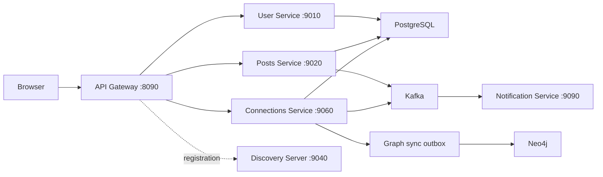

# ConnectBro

ConnectBro is a professional networking app with a static HTML/CSS/JavaScript client and Spring Boot microservices. The client uses the API Gateway and does not include mock account, post, connection, search, or notification data.

## Architecture



| Service | Current implementation | Storage / port |
| --- | --- | --- |
| API Gateway | JWT validation, CORS and service routes | 8090 |
| User Service | Signup/login, BCrypt password hashing, profiles and search | PostgreSQL, 9010 |
| Posts Service | Network feed, post creation, likes, comments and Kafka events | PostgreSQL, 9020 |
| Connections Service | Request lifecycle, graph outbox, graph traversal and ranked recommendations | PostgreSQL + Neo4j + Kafka, 9060 |
| Notification Service | Kafka consumers, unread count and mark-read APIs | PostgreSQL + Kafka, 9090 |
| Discovery Server | Eureka service discovery | 9040 |

## Local setup

Copy `.env.example` to `.env` and replace the development credentials if needed. On a fresh PostgreSQL volume, Compose initializes the four service databases. Start the local infrastructure with:

```powershell
docker compose up -d
```

This starts PostgreSQL, Neo4j and Kafka. Start Eureka and then the six services from their directories with `./mvnw spring-boot:run` (PowerShell: `./mvnw.cmd spring-boot:run`), in this order: `DiscoveryServer`, `userService`, `ConnectionsService`, `postsService`, `notification-service`, and `ApiGateway`. The Windows Maven wrapper scripts were repaired. The first run needs Maven Central access to download dependencies. The gateway is at `http://localhost:8090`.

Spring services use local defaults that match `.env.example`. If you change those values, export the same variables in the shell where Spring runs, including `POSTGRES_USER`, `POSTGRES_PASSWORD`, `NEO4J_USER`, `NEO4J_PASSWORD`, `JWT_SECRET`, `KAFKA_BOOTSTRAP_SERVERS`, and any `RECOMMENDATION_*_WEIGHT` values.

Serve the frontend from another terminal:

```powershell
cd frontend
python -m http.server 5173
```

Open `http://localhost:5173`. The frontend expects `http://localhost:8090/api/v1`. It supports account creation and sign-in, profile editing, people search, a connection feed, post creation, likes, comments, ranked recommendations, connection requests, and notifications. Open it through this local URL rather than opening `index.html` directly.

### Sample network

On the sign-in screen choose **Load a demo network**. It creates five real demo accounts, profiles, accepted connections, posts, a like, a comment, and resulting notifications through the backend APIs. This is idempotent for the included demo accounts and sample post marker; the records remain in your local databases. The main demo login is `avery.demo@connectbro.example` with password `ConnectBroDemo42!`.

### Large synthetic dataset

For load/demo data, run the idempotent SQL seed from the repository root after PostgreSQL is running:

```powershell
docker cp scripts\seed-large-demo.sql postgres_db:/tmp/seed-large-demo.sql
docker exec postgres_db psql -U springuser -d postgres -v ON_ERROR_STOP=1 -f /tmp/seed-large-demo.sql
```

It adds 1,000 synthetic profiles, 3,000 posts, 9,000 likes, 1,000 comments, 3,000 accepted connections, and 500 notifications without deleting existing rows. The generated accounts are `demo.user.00001@example.test` through `demo.user.01000@example.test`; they all use `ConnectBroDemo2026!`. Accepted connections are written to the PostgreSQL graph outbox and are copied into Neo4j when `ConnectionsService` is running against the `connectbrodb` database.

## Main API routes

- Users: `POST /api/v1/users/auth/signup`, `POST /api/v1/users/auth/login`, `GET/PUT /api/v1/users/me`, `GET /api/v1/users/profiles/{userId}`, `GET /api/v1/users/profiles/batch?ids=1,2`, `GET /api/v1/users/search?q=...`.
- Posts: `GET /api/v1/posts/core/feed`, `POST /api/v1/posts/core`, `GET/POST/DELETE /api/v1/posts/likes/{postId}`, and `/api/v1/posts/core/{postId}/comments`.
- Connections: under `/api/v1/connections/core`, send requests with `POST /requests/{targetUserId}`, list `GET /requests/incoming` and `/requests/outgoing`, accept/reject with `POST /requests/{requestId}/accept` or `/reject`, cancel with `DELETE /requests/{requestId}`, list/remove connections with `GET /connections` and `DELETE /connections/{otherUserId}`, and fetch recommendations with `GET /recommendations?page=0&size=20`.
- Notifications: `GET /api/v1/notifications/core`, `GET /unread-count`, `POST /{notificationId}/read`, and `POST /read-all`.

The login endpoint returns the JWT as plain text. Protected requests send it as `Authorization: Bearer <token>`.

## Recommendation engine

The Connections Service traverses Neo4j for second- and third-degree candidates, excludes self, accepted connections and pending requests, counts mutual graph neighbors, and obtains profile data in one batch from User Service. Profiles include skills, interests, current goals and a professional headline. A content-based TF-IDF cosine model compares those dimensions. It expands common abbreviations (such as ML/AI/UX) and goal terms (such as mentorship/mentoring), while inverse document frequency gives rarer terms more influence. This is combined with network proximity and mutual connections, with structured match percentages and human-readable reasons in the response. The recommendations screen also accepts an optional current goal (for example, “find an AI mentor”) and ranks reachable profiles against that goal. Mutual connections provide a simple network-strength explanation, while profile similarity provides a cold-start fallback when there is no behavioral history. Default configurable score weights are 25 for second-degree proximity, 10 for third-degree proximity, up to 15 for mutual connections, 20 for skills, 10 for interests, 15 for goal alignment, and 5 for professional focus. Tune them with the `RECOMMENDATION_*_WEIGHT` variables in `.env`. `recommendation_engine.py` uses the same content-based scoring for local graph data. This is a content-based model; it does not claim to learn from historical user clicks.

Accepted connection state is persisted in PostgreSQL. Accept/remove operations write a durable outbox event in the same SQL transaction; a worker retries Neo4j synchronization every five seconds. Recommendation results also consult PostgreSQL to suppress accepted/pending candidates while the graph catches up.

## Checks

Run the local graph scenarios with:

```powershell
python -m unittest discover -s tests -v
```

Run Java tests from a service directory with `./mvnw test` (PowerShell: `./mvnw.cmd test`). Context and integration tests need PostgreSQL, Neo4j, Kafka, and Eureka running.

## Current limitations

The static frontend is implemented, and all Java modules compile. The focused connection/recommendation tests and standalone graph tests pass. Full end-to-end service verification was not possible in this environment because Docker Engine was unavailable. Connection-request notifications publish directly to Kafka rather than through an outbox. Database schema evolution still relies on Hibernate `ddl-auto=update`, and service URLs are local-development settings.
